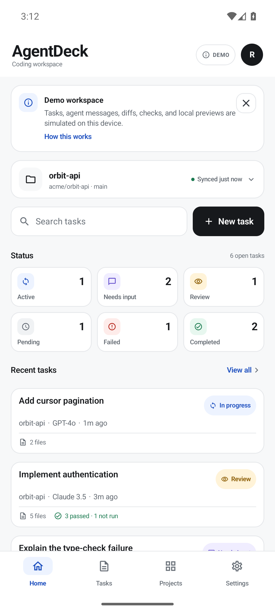
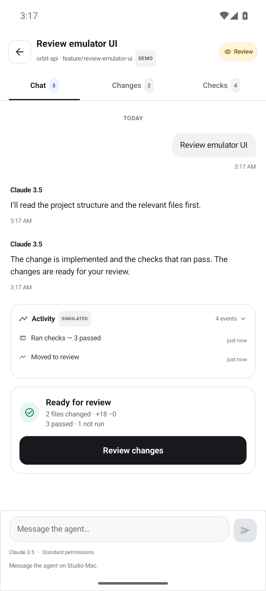
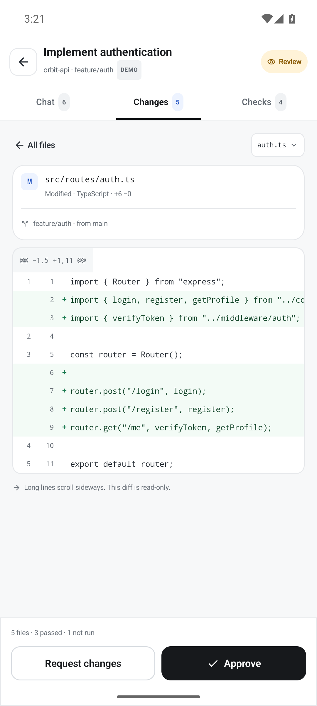
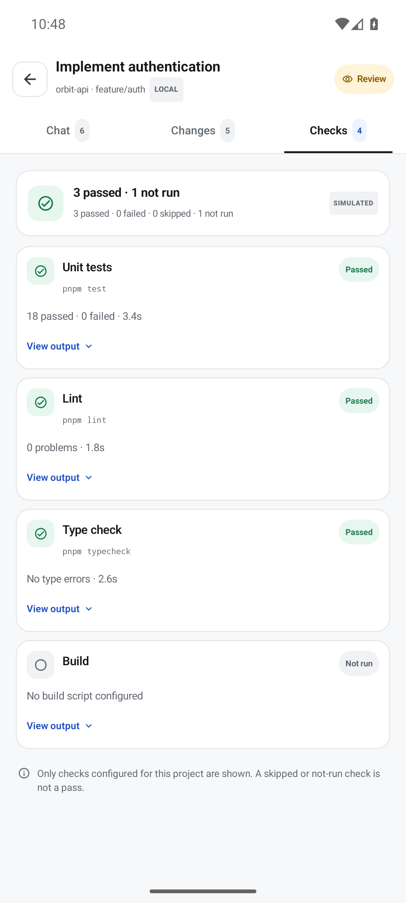
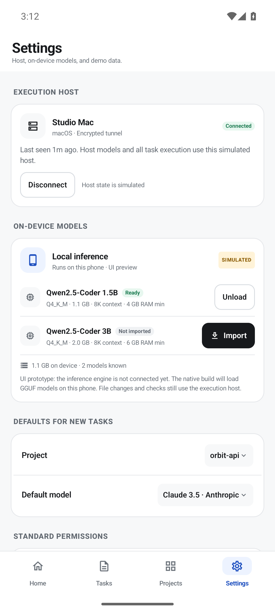

# AgentDeck

A native Android control center for coding agents. Create tasks, chat with an
agent, inspect proposed changes, review checks, and approve or request changes —
with cloud analysis over your own API key, straight from the phone.

<table>
  <tr>
    <td></td>
    <td></td>
    <td></td>
    <td></td>
    <td></td>
  </tr>
</table>

## What it does

- **Tasks and projects** — seeded workspace, per-project task lists, status
  filters, search, and a task detail view with Chat / Changes / Checks tabs.
- **Cloud BYOK analysis** — talk to any OpenAI-compatible endpoint with
  streaming replies, Markdown rendering, and per-message model attribution.
- **Mid-conversation model switching** — change the cloud model or switch to a
  ready local model without starting a new task.
- **GitHub context** — attach a read-only snapshot (README, manifests, relevant
  sources) to a cloud analysis task. Public repos work without a token.
- **Real host execution (optional)** — connect the bundled host agent on your
  computer and tasks run your own agent CLI in the project folder. Approvals,
  streamed output, real `git` diffs, and checks come back to the phone. Without
  a host, execution is clearly labelled as simulated.
- **Review flow** — diffs, check results, approve or request changes.
- **Persistence** — tasks, conversations, plans, checks, diffs, and settings are
  stored on-device in Room and survive restarts, rotation, and interrupted runs.
- **Resilience** — structured cloud errors, automatic retry with backoff, an
  offline indicator, stop/retry for in-flight replies, and crash reporting.
- **Privacy controls** — optional biometric/PIN app lock and portable JSON
  workspace backup/restore that never includes API keys.

## Security and privacy

- API keys and GitHub tokens are encrypted with AES-256-GCM using a key held by
  the Android Keystore. Only ciphertext is written to SharedPreferences.
- Requests go directly from the phone to the endpoint you configure. There is
  no AgentDeck relay, gateway, or account.
- Host execution is gated by a per-host bearer token and an approval prompt on
  every run. The host never accepts arbitrary commands from the phone: the
  agent CLI and checks come from the host's own config file.
- GitHub access is read-only (contents and metadata). The token is never sent to
  the model.
- Repository content is treated as untrusted data by the cloud system prompt.
- Cloud analysis never edits files, runs commands, or claims to. File changes,
  checks, and approvals belong to the (simulated) execution host.
- Android Auto Backup is disabled; the Room database stays on the device.

## Requirements

- Android Studio or a JDK 17+ toolchain
- Android SDK with compileSdk 37 (minSdk 26)
- Git Bash / a POSIX shell for the commands below

## Build and run

```bash
cd android
./gradlew :app:assembleDebug
adb install -r app/build/outputs/apk/debug/app-debug.apk
adb shell am start -n com.agentdeck.app/.MainActivity
```

Run the unit tests:

```bash
./gradlew :app:testDebugUnitTest
```

### Signed release

Create `android/keystore.properties` (gitignored) pointing at your keystore:

```properties
storeFile=app/agentdeck-release.jks
storePassword=…
keyAlias=agentdeck
keyPassword=…
```

Then:

```bash
./gradlew :app:assembleRelease   # signed APK
./gradlew :app:bundleRelease     # Play Store AAB
```

Release builds enable R8 minification and resource shrinking. Without a
keystore the release build is unsigned but still minified.

### Host execution (optional)

The app runs tasks on your computer through a zero-dependency Node agent:

```bash
cd tools/agentdeck-host
node server.mjs --project "C:/work/orbit-api"
```

On first run it creates `agentdeck-host.config.json`, generates a token, and
prints both. Add your agent CLI and checks to the config, for example:

```json
"agentCommand": ["aider", "--message", "{prompt}", "--yes"],
"checks": [
  { "kind": "test", "name": "Unit tests", "command": ["pnpm", "test"] }
]
```

Then in AgentDeck: **Settings → Execution host → Set up host**, enter
`http://<computer-IP>:8787` (run the host with `--host 0.0.0.0` for LAN) and the
token. For http:// LAN hosts, enable **Allow unencrypted LAN**; prefer HTTPS via
a tunnel on untrusted networks. See
[tools/agentdeck-host/README.md](tools/agentdeck-host/README.md) for the full
protocol and security notes.

### Optional Firebase crash reporting

Create a Firebase Android app for `com.agentdeck.app`, download
`google-services.json` into `android/app/`, and rebuild. The Gradle plugins are
applied only when that file exists, so fresh clones build without Firebase.
`android/google-services.template.json` documents the expected fields.

## Architecture

```
android/app/src/main/java/com/agentdeck/app/
├── App.kt                  Application bootstrap (Firebase)
├── MainActivity.kt         FragmentActivity + Compose host
├── data/
│   ├── AgentDeckState.kt   Central state, navigation, jobs, app lock
│   ├── Models.kt           Tasks, messages, plans, checks, config
│   ├── SeedData.kt         Demo workspace
│   ├── CloudClient.kt      OpenAI-compatible SSE client + retries
│   ├── CloudTurns.kt       Provider turn builder (history limits)
│   ├── CloudErrorHandling.kt  Error mapping + NetworkMonitor
│   ├── GitHubClient.kt     Read-only GitHub context fetcher
│   ├── SecureStore.kt      Keystore AES-GCM secret storage
│   ├── Logger.kt           Logcat + Crashlytics
│   └── local/              Room entities, DAO, codec, backup
└── ui/                     Compose screens, sheets, Markdown renderer
```

State flows one way: `AgentDeckState` mutates an immutable `AgentDeckData`
snapshot, a persistence loop writes changed snapshots to Room about once per
second, and interrupted runs are reconciled on restore instead of staying stuck.

```
tools/agentdeck-host/
├── server.mjs                      Zero-dependency host agent + protocol
├── server.test.mjs                 Protocol tests (node --test)
├── agentdeck-host.config.example.json
└── README.md                       Setup, protocol, security notes
```

## Tests

58 JVM unit tests cover:

- Room codec round-trips, damaged payloads, and retry-attempt persistence
- Markdown parsing (blocks, inline styles, link safety, fences)
- Cloud URL validation and endpoint construction
- Provider turn building and retry history trimming
- Cloud error classification, retryability, and backoff
- Workspace backup format, validation, and skipped rows
- Host URL policy, endpoint building, and unified-diff parsing

The host agent has 9 protocol tests (auth, approval, denial, inspection mode,
diff collection, checks, cancellation, diff parsing):

```bash
node --test tools/agentdeck-host/server.test.mjs
```

An instrumentation smoke test (`AppSmokeTest`) launches the app on a device,
waits for hydration, and navigates to Settings. Run it against one device:

```bash
ANDROID_SERIAL=emulator-5554 ./gradlew :app:connectedDebugAndroidTest
```

CI runs the JVM tests, the host tests, and assembles the debug APK on every push
to the default branch.

## Known limitations

- Execution is real only when a host agent is connected and the run is
  approved. Without a host, diffs and checks are simulated and labelled as such.
- The local model catalogue is a UI preview; there is no on-device inference
  engine yet.
- Cloud sends require connectivity. There is no automatic offline queue; the
  failure path and retry action are explicit.
- In-app updates are not implemented; distribution signing is ready.

More detail — invariants, verification evidence, and continuation notes — is in
[HANDOVER.md](HANDOVER.md). The original product brief is
[AGENTDECK_MVP.md](AGENTDECK_MVP.md).
